<p align="center">
  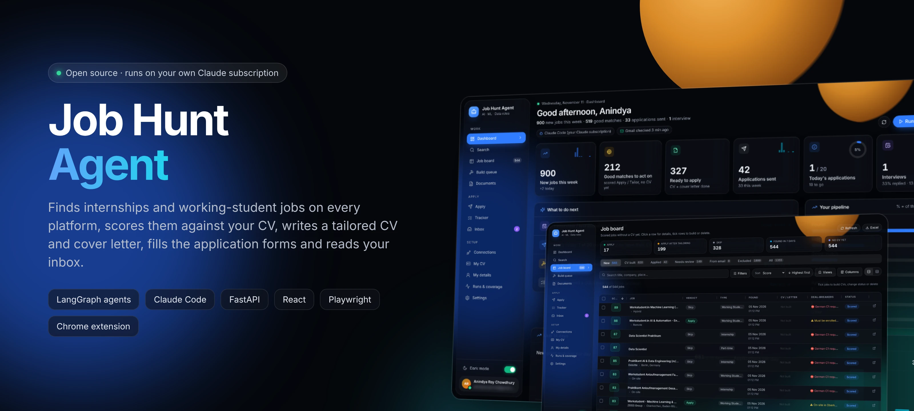
</p>

<p align="center">
  <a href="#-quick-start"></a>
  
  
  
</p>

<p align="center">
  
  
  
  
  
  
  
</p>

<h3 align="center">An AI job-search co-pilot that runs on your own computer and your own Claude subscription.</h3>

<p align="center">
It searches every job platform, scores each posting against <b>your</b> CV, writes a one-page tailored CV and a real cover letter,<br>
fills the application form in your own browser while you watch, and keeps your tracker up to date from your inbox.<br>
<b>You stay in control:</b> the app never presses Submit, never solves a captcha, and never invents a skill you don't have.
</p>

---

## ✨ What it does

<table>
<tr>
<td width="33%" valign="top">

### 🔎 Finds every job
Searches **LinkedIn, StepStone, XING, Glassdoor, Indeed, Wellfound**, official company feeds (Greenhouse, Lever, Ashby, SmartRecruiters, Personio), the German **Bundesagentur für Arbeit**, Arbeitnow, RemoteOK, and the rest of the web through Claude's web search. Duplicates across sites and runs are merged.

</td>
<td width="33%" valign="top">

### 🎯 Scores against your CV
Every job is classified (internship / working student / part-time / full-time) and scored out of 100 with a recruiter rubric: skills, experience, title fit, education, language, type and location. Deal-breakers like "German C1 required" are flagged, not hidden.

</td>
<td width="33%" valign="top">

### 📝 Writes tailored documents
For the jobs you tick, it writes a **one-page CV** and a **cover letter** in your own Word layout. It picks the projects closest to the job from your CV **and your GitHub**, shows the **ATS score before and after**, and runs a recruiter-style review. A checker and automatic QA reject anything not backed by your CV or your own READMEs. You choose the model (Haiku, Sonnet, Opus, Fable) and how many projects.

</td>
</tr>
<tr>
<td valign="top">

### 🧩 Fills applications
A **browser extension** works in your normal Chrome or Edge, with your own logins. It fills the form from your details, uploads the right PDFs, answers screening questions honestly (salary, availability, motivation from your cover letter), and leaves Submit to you.

</td>
<td valign="top">

### 📬 Reads your inbox
Connect Gmail with an app password, read-only. Confirmations mark jobs **Applied**, rejections **Rejected**, invitations land in **To do**, and jobs from StepStone/Glassdoor/XING/LinkedIn alerts are added, but only the ones that fit your CV.

</td>
<td valign="top">

### 📊 Shows the whole pipeline
A glass dashboard with what to do next, your funnel from *found* to *offer*, 14-day activity, sources, inbox highlights and a daily application goal. Dark and light themes.

</td>
</tr>
</table>

---

## 📸 Screens

<p align="center">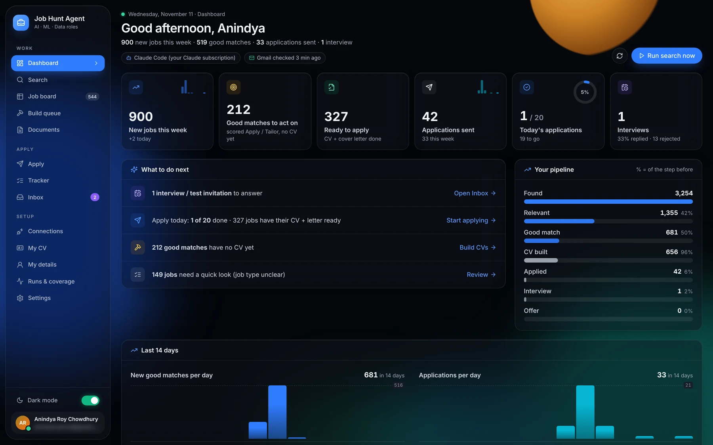</p>
<p align="center"><sub><b>Dashboard</b> · what to do next, pipeline funnel, daily goal, 14-day activity</sub></p>

<table>
<tr>
<td width="50%">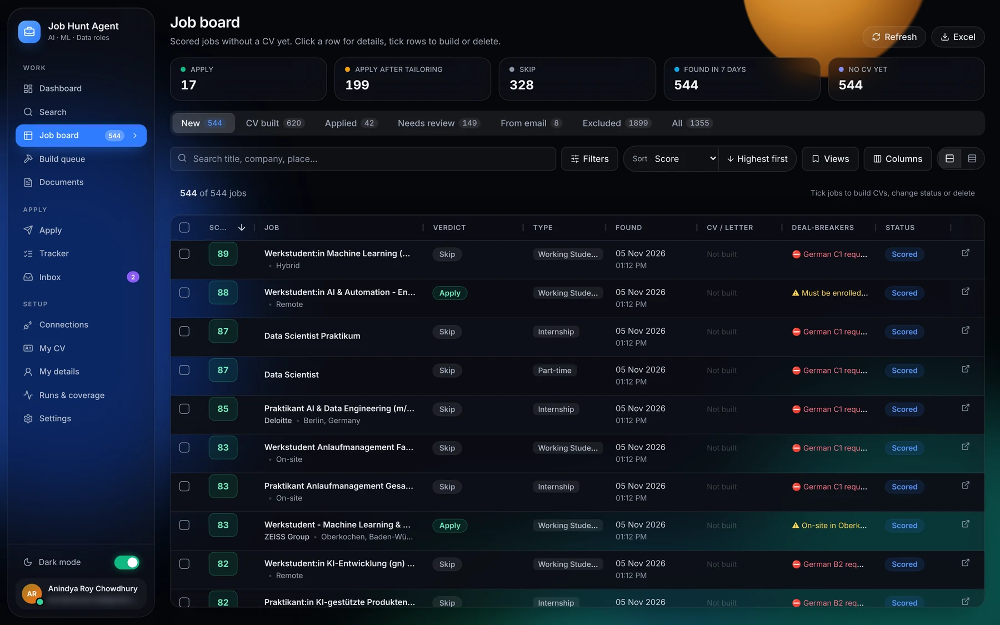<br><sub><b>Job board</b> · every job scored, deal-breakers, filters, saved views</sub></td>
<td width="50%">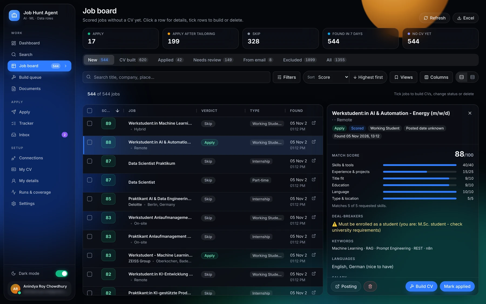<br><sub><b>Job detail</b> · score breakdown, matched skills, blockers, one-click Build CV</sub></td>
</tr>
<tr>
<td>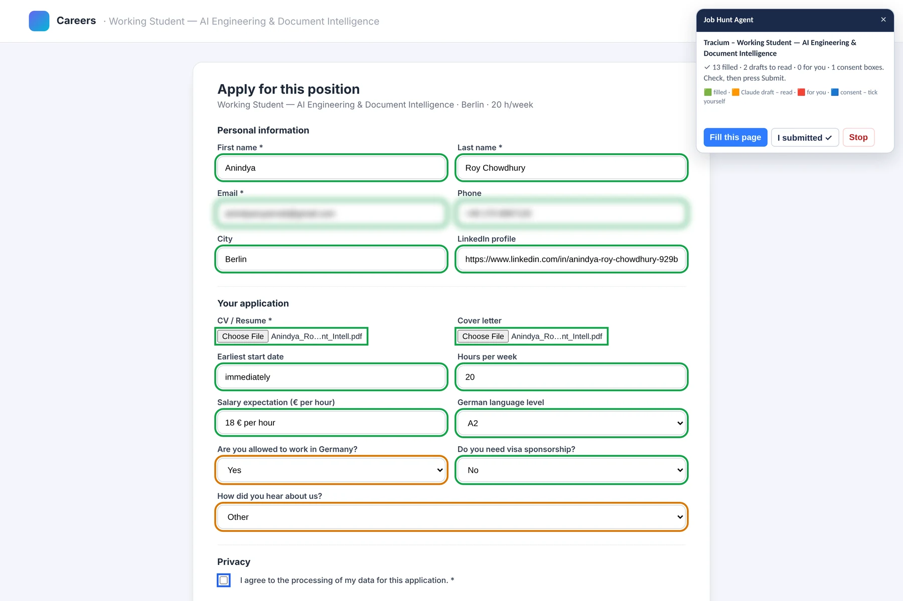<br><sub><b>Browser helper</b> · fills the form in your own browser (green = filled, amber = Claude draft to read, red = for you, blue = consent for you)</sub></td>
<td>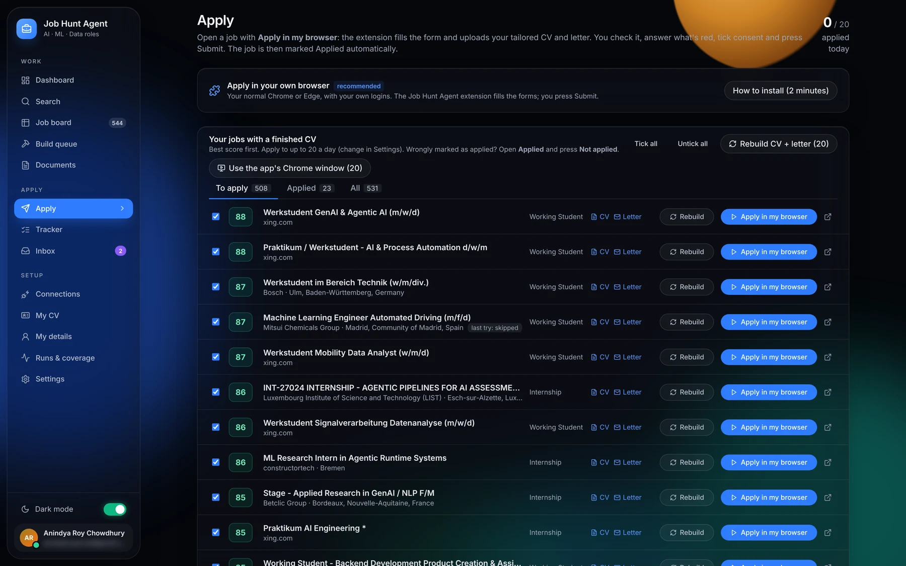<br><sub><b>Apply</b> · your queue of jobs with a finished CV + letter, rebuild, undo a wrong "applied"</sub></td>
</tr>
<tr>
<td>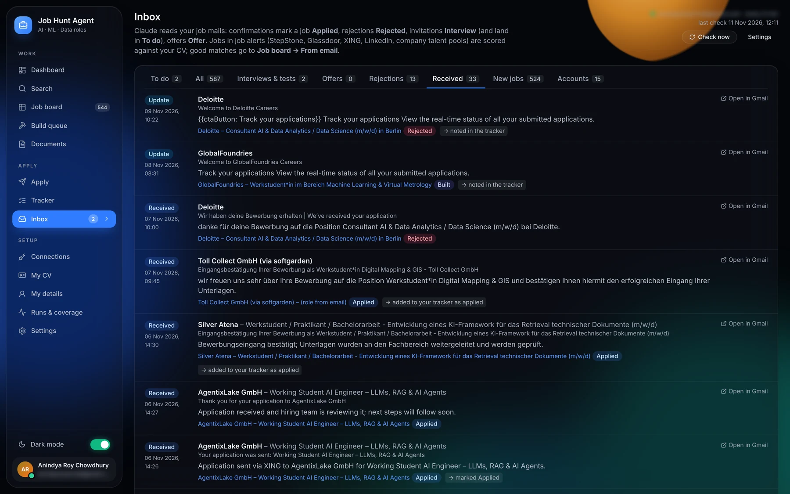<br><sub><b>Inbox</b> · company emails sorted and linked to the right job</sub></td>
<td>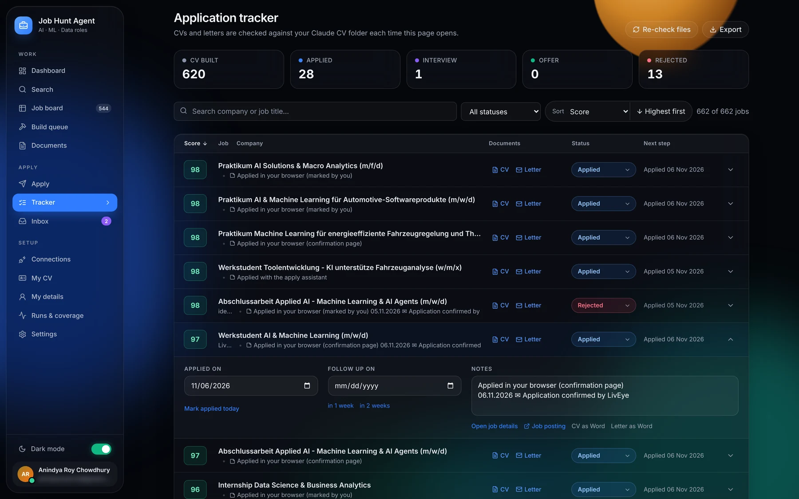<br><sub><b>Tracker</b> · status, follow-ups, notes, documents per application</sub></td>
</tr>
<tr>
<td>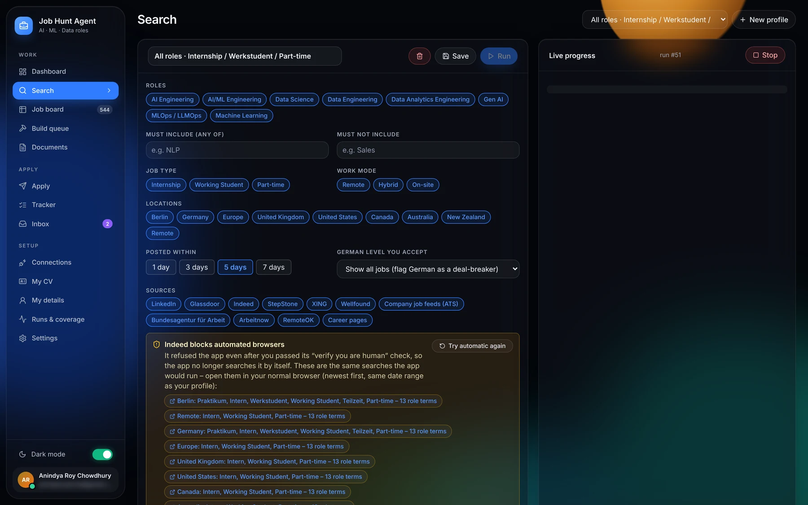<br><sub><b>Search</b> · filter profiles and live progress of every agent</sub></td>
<td>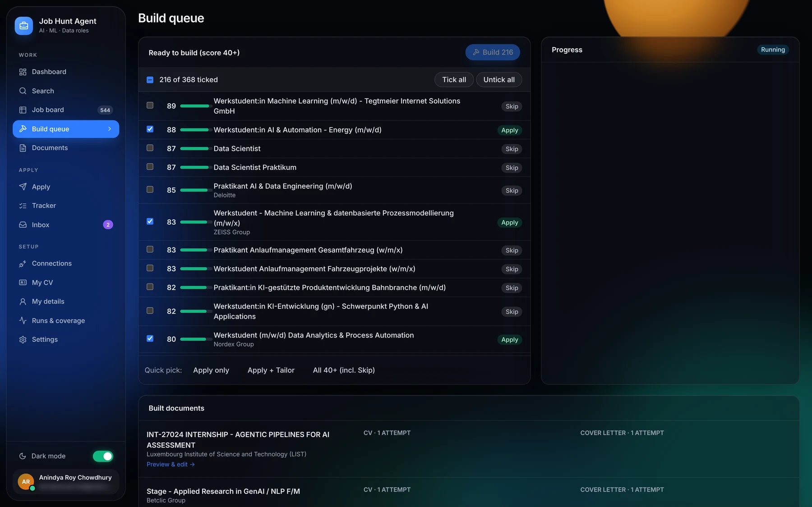<br><sub><b>Build queue</b> · pick jobs, watch CVs and letters being written and checked</sub></td>
</tr>
<tr>
<td>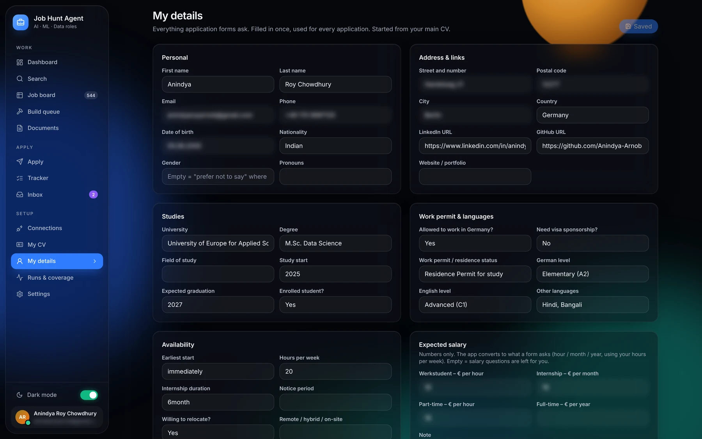<br><sub><b>My details</b> · everything application forms ask, stored once (blurred here)</sub></td>
<td>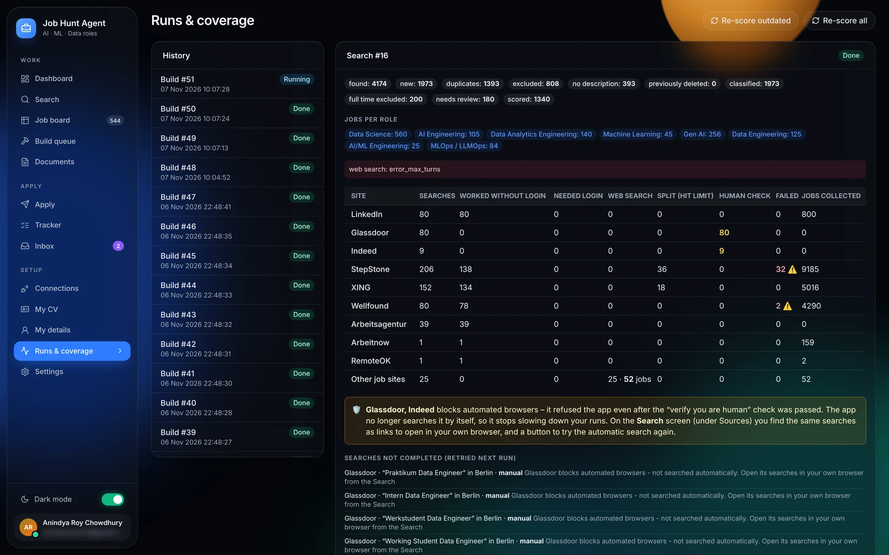<br><sub><b>Runs & coverage</b> · what each site returned, what was blocked, what to retry</sub></td>
</tr>
<tr>
<td>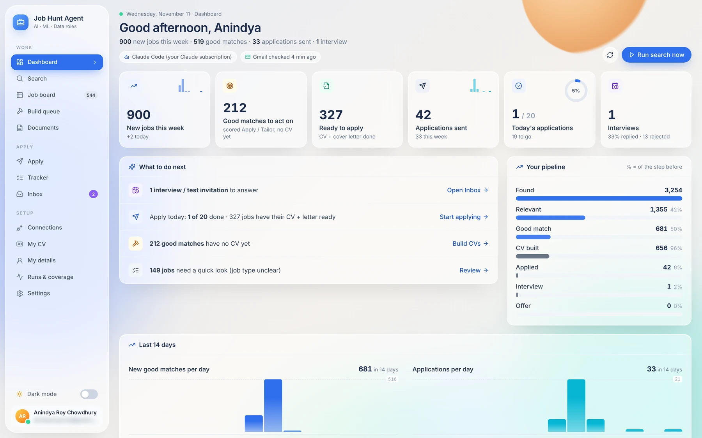<br><sub><b>Light theme</b> · one switch in the sidebar</sub></td>
<td>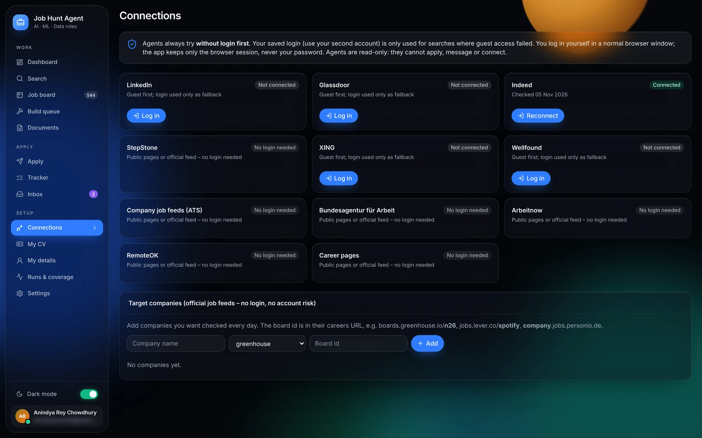<br><sub><b>Connections</b> · optional logins (guest first), official company feeds</sub></td>
</tr>
</table>

---

## 🧠 How it works

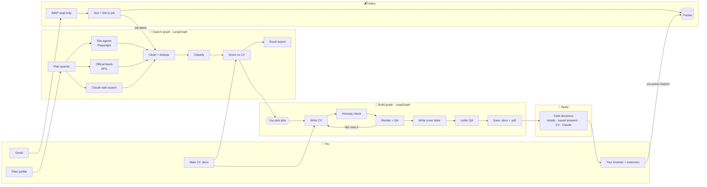

Everything runs **locally** in one Python process: FastAPI serves the React app and a WebSocket for live progress, LangGraph runs the search and build pipelines in the background, SQLite stores your data, and Claude is reached either through **Claude Code** (your Pro/Max subscription) or an API key.

👉 **The full technical walkthrough** (every node, the scoring rubric, the honesty checks, the form-filling decision engine, the inbox state machine, the theme system, the data model and the tests) is in **[docs/ARCHITECTURE.md](docs/ARCHITECTURE.md)**.

---

## 🚀 Quick start

### 1. What you need

| | |
|---|---|
| **Python 3.11+** | [python.org/downloads](https://www.python.org/downloads/) (Windows: tick *Add python.exe to PATH*) |
| **A Claude subscription** | Claude **Pro or Max** (used through Claude Code). An API key works too; see below |
| **Word → PDF** | Microsoft Word (Windows, used automatically) **or** [LibreOffice](https://www.libreoffice.org/) |
| **Chrome or Edge** | for the apply helper extension |

No Node.js needed: the built web app is included in `frontend/dist`.

### 2. Install the app

```bash
git clone https://github.com/Anindya-Arnob/job-hunt-agent.git
cd job-hunt-agent
```

| Windows | macOS / Linux |
|---|---|
| Double-click **`scripts\install.bat`** | `./scripts/install.sh` |

The installer creates a Python environment in `.venv`, installs the packages and the Chromium browser for the site agents, copies `.env.example` to `.env`, and checks for Claude Code.

### 3. Connect your Claude subscription (Claude Code)

The app uses the `claude` command from **Claude Code** to write CVs and letters, run web searches, draft form answers and read job emails. Install it and log in once:

| Windows (PowerShell) | macOS / Linux / WSL |
|---|---|
| `irm https://claude.ai/install.ps1 \| iex` | `curl -fsSL https://claude.ai/install.sh \| bash` |

Then open a new terminal, run **`claude`**, and log in with your Claude Pro or Max account in the browser window that opens. Check it with `claude --version`. The app finds `claude` on your PATH by itself; if it doesn't, set `CLAUDE_CLI_PATH` in `.env`. ([Official setup guide](https://code.claude.com/docs/en/setup))

> **Using an API key instead?** Put `ANTHROPIC_API_KEY=...` in `.env` (from [console.anthropic.com](https://console.anthropic.com)). The API also runs classification and scoring through Claude (pay per use, with a daily budget cap). Without Claude Code or a key, the app still runs on **offline rules**, which is handy for trying it out.

### 4. Start it

| Windows | macOS / Linux |
|---|---|
| Double-click **`scripts\start.bat`** | `./scripts/start.sh` |

The app opens at **http://127.0.0.1:8780**. Close the window (or press Ctrl+C) to stop it.

### 5. Install the browser helper (optional, for applying)

1. Open `chrome://extensions` (or `edge://extensions`) → switch on **Developer mode**.
2. **Load unpacked** → select the `extension` folder of this project.
3. In the app, open **Apply**. The card turns green when the helper is connected.

---

## 🧭 First run

1. **My CV**: upload your main CV (.docx or .pdf), check what was read, *Confirm & save*. Your Word layout becomes the template.
2. **My details**: check the form answers (filled from your CV): work permit, availability, salary expectations, languages.
3. **Search**: edit the default filter profile (roles, job types, locations, sources) and press **Run**. Watch every agent live.
4. **Job board**: sort by score, read deal-breakers, tick the jobs you like → **Build CVs**.
5. **Documents**: preview, quick-edit or rebuild. Files land in `<JOB_DIR>/Claude CV/<Company>/` as `.docx` and `.pdf`.
6. **Apply**: *Apply in my browser* opens the posting; the helper fills the form; you read it and press **Submit**.
7. **Inbox**: connect Gmail with an [app password](https://myaccount.google.com/apppasswords) so replies update your tracker by themselves.

---

## ⚙️ Configuration

All settings live in `.env` (copied from [`.env.example`](.env.example)); most can also be changed on the **Settings** page.

| Setting | Default | What it does |
|---|---|---|
| `ANTHROPIC_API_KEY` | *(empty)* | Use the Claude API instead of / in addition to Claude Code |
| `CLAUDE_CLI_PATH` | auto | Path to `claude` if it is not on your PATH |
| `WEBSEARCH_CLI_MODEL` | `sonnet` | Model Claude Code uses for web search and form answers |
| `JOB_DIR` | `Documents/JobHunt` | Where CVs, letters and Excel exports are written |
| `VERDICT_SKIP_BELOW` / `VERDICT_APPLY_FROM` | `40` / `65` | Score thresholds for *Skip* / *Apply after tailoring* / *Apply* |
| `BUILD_MIN_SCORE` | `40` | Jobs below this are never built |
| `CV_MODEL` / `LETTER_MODEL` / `CV_EFFORT` | Sonnet | Model and effort for the CV and the letter (`haiku`, `sonnet`, `opus`, `fable`) |
| `CV_PROJECTS` | `3` | Projects on each CV (2–6) |
| `GITHUB_PROJECTS` / `GITHUB_USER` | on / your CV's link | Pick projects from your GitHub READMEs too |
| `ATS_TARGET` | `75` | Below this the writer adds the posting's exact words for skills you have |
| `RECRUITER_REVIEW` / `HUMANIZE` | on / on | Recruiter-style review pass; human-writing rules |
| `CLAUDE_LEAN` | on | Lean Claude Code calls (about 3k instead of 36k input tokens) |
| `APPLY_DAILY_LIMIT` | `20` | Daily application goal on the Apply page and dashboard |
| `PAGE_DELAY_SECONDS` / `MAX_PAGES_PER_SEARCH` | `3` / `3` | Human pacing for the browser agents |
| `SCHEDULE_ENABLED` / `SCHEDULE_TIME` | `false` / `07:10` | Morning search + score (while the app is open) |
| `PORT` | `8780` | Local port of the app |

---

## 🛡️ Privacy and responsible use

- **Your data stays on your computer.** SQLite database in `data/`, documents in your job folder, browser sessions in your user profile. Nothing is uploaded except the text sent to Claude for a task.
- **No passwords are stored for job sites.** You log in yourself in a normal browser window; only the session is kept. The Gmail app password is stored locally and can only read mail; delete it at Google any time.
- **The app never submits an application, never solves a captcha and never answers security questions.** Consent boxes are left for you. Every Claude-drafted answer is highlighted for you to read.
- **Honesty is enforced in code:** CVs and letters may only contain tools, numbers and employers from your main CV; skill questions are answered "yes" only when your CV shows the skill.
- **Respect the sites' terms.** Some platforms (e.g. LinkedIn, Glassdoor, Indeed) restrict automated browsing. The agents are read-only, go guest-first, use human pacing, and hand blocked sites to you as links. Keep runs to about once a day.

---

## 🧰 Tech stack

| Layer | Technology |
|---|---|
| Agents & pipelines | **LangGraph** (fan-out with `Send`, human-in-the-loop `interrupt`, SQLite checkpointer) |
| Claude | **Claude Code CLI** (`claude -p`, your subscription) or **Anthropic API** via `langchain-anthropic`; Pydantic-validated structured outputs |
| Backend | **FastAPI**, Uvicorn, WebSockets, **SQLModel / SQLite**, APScheduler |
| Browser automation | **Playwright** (Chromium, persistent profiles) |
| Documents | python-docx (render in your layout), LibreOffice / Word (PDF), pypdfium2 (previews), openpyxl (Excel) |
| Mail | IMAP (read-only, `BODY.PEEK`), rule-based + Claude classification |
| Frontend | **React 18**, Vite, **Tailwind CSS** with a CSS-variable theme (dark glass / light frost), AG Grid, Inter |
| Extension | Chrome / Edge **Manifest V3** (service worker + content script) |
| Tests | **pytest** (130+ tests), Playwright end-to-end UI test, extension end-to-end test |

---

## 🗂️ Project structure

```
job-hunt-agent/
├── backend/
│   ├── jobagent/
│   │   ├── api/          FastAPI app (REST + WebSocket) and background runs
│   │   ├── graphs/       LangGraph: search_graph.py, build_graph.py
│   │   ├── steps/        planner, clean & dedupe, classify, score, write, export
│   │   ├── agents/       one Playwright agent per job site + page extraction
│   │   ├── feeds/        official job feeds + Claude web-search agent
│   │   ├── cv/           CV parser, versions, template
│   │   ├── docs/         Word rendering, PDF conversion, QA checks
│   │   ├── apply/        form-field decisions, Claude drafts, extension bridge, app-window session
│   │   ├── mail/         Gmail reader, mail sorter, tracker updates
│   │   ├── llm.py        Claude access (API / Claude Code / offline)
│   │   └── models.py     database tables
│   └── tests/            pytest suite, fixtures, fake job sites, UI e2e
├── frontend/             React app (src/), built app (dist/), theme generator (theme/)
├── extension/            Chrome / Edge extension (Manifest V3)
├── scripts/              install / start / test scripts (Windows .bat, macOS/Linux .sh)
└── docs/                 ARCHITECTURE.md, screenshots
```

---

## 🧪 Development

```bash
# backend tests (uses fake Claude, fake job sites and a fake mailbox, no network)
cd backend && ../.venv/bin/python -m pytest -q        # Windows: scripts\run_tests.bat

# frontend (only needed if you change the UI)
cd frontend && npm install && npm run dev               # dev server with hot reload, proxies the API on :8780
npm run build                                           # writes frontend/dist, which the app serves

# colours: edit frontend/theme/gen_theme.py, then
python frontend/theme/gen_theme.py frontend/theme/twcolors.json frontend/src/theme-tokens.css frontend/theme/colors.js
```

Adding a job site: describe it in `backend/jobagent/agents/sites.py` (search URL, card selectors, link patterns); the site agent, planner and coverage report pick it up. Adding an official feed: one async function in `backend/jobagent/feeds/feeds.py`.

---

## ❓ FAQ

<details><summary><b>Do I need to pay for the Claude API?</b></summary>

No. With Claude Code logged in to your Claude Pro or Max subscription, the app uses that for the heavy work (CVs, letters, web search, form answers, mail). Classification and scoring then use fast offline rules. An API key is optional.
</details>

<details><summary><b>Which countries and roles does it support?</b></summary>

The defaults target internships, working-student and part-time AI / ML / data roles in Germany, but roles, job types, locations and sources are all editable filter profiles. German-language requirements are detected and shown as deal-breakers.
</details>

<details><summary><b>A site shows "Verify you are human" or blocks the agent.</b></summary>

The app never bypasses checks. In window mode you solve the check yourself; if a site still refuses automation, it switches to *manual mode* and gives you ready-made search links to open in your own browser. The coverage report shows which searches were affected.
</details>

<details><summary><b>Another app already uses port 8780.</b></summary>

The start window says so. Put `PORT=8781` in `.env` and update `APP` at the top of `extension/background.js` and `extension/popup.js` to the same port.
</details>

<details><summary><b>Can it apply without me?</b></summary>

No, by design. It prepares and fills; you read and press Submit. Companies receive applications written and sent by you.
</details>

---

## 📄 License

[MIT](LICENSE) © 2026 Anindya Roy Chowdhury. Built with [Claude Code](https://code.claude.com).

<p align="center"><sub>If this helps your job search, a ⭐ on the repo helps other students find it.</sub></p>
