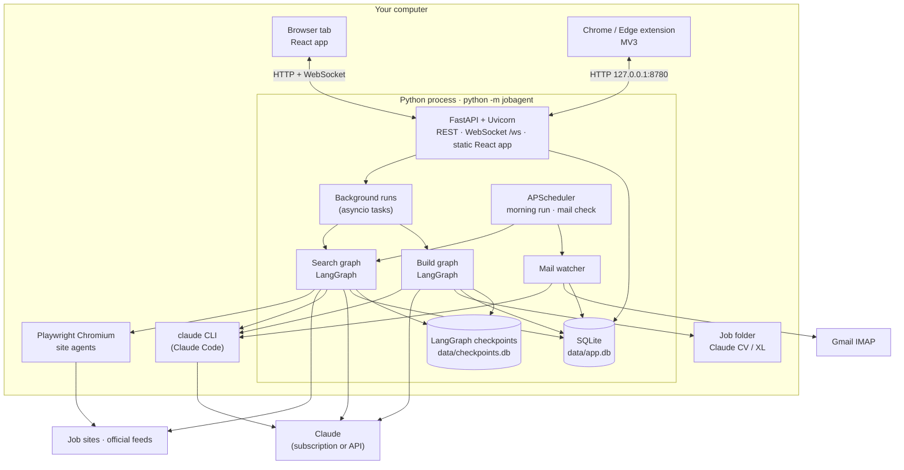
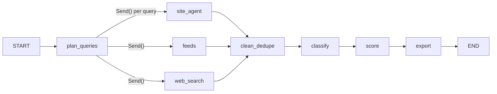
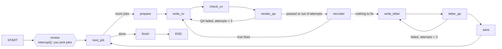
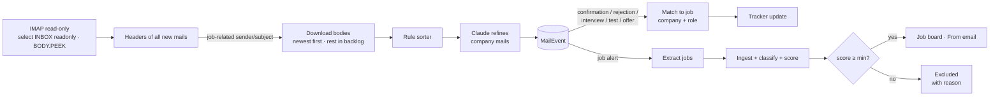

# Job Hunt Agent: how it works

This document explains the whole system in technical detail: the processes, the two LangGraph pipelines, how Claude is called, how jobs are scored, how documents are written and checked, how application forms are filled, how the inbox is read, and how the UI is built. File paths are relative to `backend/jobagent/` unless stated otherwise.

**Contents**

1. [Runtime overview](#1-runtime-overview)
2. [Claude access layer](#2-claude-access-layer)
3. [Search pipeline](#3-search-pipeline-search-graph)
4. [Classification and scoring](#4-classification-and-scoring)
5. [Build pipeline: CVs and cover letters](#5-build-pipeline-cvs-and-cover-letters)
6. [Your CV, versions and template](#6-your-cv-versions-and-template)
7. [Applying: the form-filling engine](#7-applying-the-form-filling-engine)
8. [Inbox: reading job mails](#8-inbox-reading-job-mails)
9. [Data model](#9-data-model)
10. [Frontend and theme system](#10-frontend-and-theme-system)
11. [Scheduling, events and background runs](#11-scheduling-events-and-background-runs)
12. [Safety, privacy and honesty rules](#12-safety-privacy-and-honesty-rules)
13. [Testing](#13-testing)
14. [Extending the app](#14-extending-the-app)

---

## 1. Runtime overview

- **One process.** `__main__.py` checks that the port is free, opens the browser and starts Uvicorn with `api/main.py`. The React app is served from `frontend/dist`, so users don't need Node.js.
- **Long work runs in the background.** `api/runs.py` starts a search or build as an asyncio task, records it in the `Run` table and streams progress to every open tab through `events.py` (an in-process pub/sub that the WebSocket `/ws` forwards).
- **State lives in SQLite** (`models.py`, SQLModel). LangGraph checkpoints (needed to pause a build for your review) live in a separate SQLite file.
- **Browser sessions** for logged-in sites live outside the project folder (`%LOCALAPPDATA%\JobHuntAgent\profiles` on Windows), so the repo never contains cookies.

---

## 2. Claude access layer

`llm.py` is the only place that talks to Claude. Every call is **structured**: the caller passes a Pydantic schema (`schemas.py`) and gets a validated object back.

| Mode (`settings.effective_llm_mode`) | When | How |
|---|---|---|
| `api` | `ANTHROPIC_API_KEY` set | `langchain-anthropic` with structured output. Each node uses a model tier (`NODE_TIER`: fast for page reading and classification, smart for scoring and writing). A cost tracker sums tokens × price per run and per day; a run stops before it would exceed `DAILY_BUDGET_USD`. |
| `fake` + Claude Code | no key, `claude` found | Nodes in `CLI_NODES` (`write_cv`, `write_letter`, `read_mail`, `mail_jobs`) run through `claude -p --output-format json` with the JSON schema embedded in the prompt. The result is parsed and validated, with one retry on invalid JSON. |
| `fake` | neither | Deterministic offline implementations (heuristic classifier, rubric scorer, template-based writer) so the app is fully usable for trying out. |

Claude Code is discovered via `CLAUDE_CLI_PATH`, then `PATH`, then the default install locations on Windows (`%USERPROFILE%\.local\bin\claude.exe`, `%APPDATA%\npm\claude.cmd`). It is always run in a temporary working directory with file-editing and shell tools disallowed (`--disallowedTools Bash,Edit,Write,...`), so it can only think and, for the web-search agent, search the web.

**Lean mode** (`claude_code.py`, on by default). A plain `claude -p` call carries Claude Code's own system prompt, every tool definition, your skills, plugins and MCP servers: about 36,000 input tokens before the app says a word. Lean mode passes the node's prompt with `--system-prompt-file`, adds `--disable-slash-commands`, `--strict-mcp-config`, `--no-session-persistence` and disallows every tool, which brings a call down to about 3,000 input tokens. The app reads `claude --help` once and only passes options your Claude Code version knows. With lean mode off, skills can be switched on or off as a group and each installed plugin on its own (written to a temporary `--settings` file as `enabledPlugins`); your own Claude Code settings are never changed. Settings shows the input and output tokens of the last calls.

**Model choice.** `CV_MODEL` / `LETTER_MODEL` (Settings → CV building) pick the model for `write_cv`, `check_cv`, `review_cv` and `write_letter`: `haiku`, `sonnet`, `opus` or `fable` (passed as `--model` to Claude Code, mapped to the API model id with a key), plus `CV_EFFORT` for `--effort`.

Other Claude-powered pieces that call the CLI directly with their own prompt and parser:

- **Web-search agent** (`feeds/websearch.py`): `claude -p --output-format stream-json` with the WebSearch tool, a turn budget of `searches × 2 + 10`, authentication-error detection and salvage of partial results.
- **Form answers** (`apply/draft.py`): one batch call per page answers every open field at once (see §7).

---

## 3. Search pipeline (search graph)

`graphs/search_graph.py` builds a LangGraph `StateGraph`:

### 3.1 `plan_queries`: the query planner (`steps/planner.py`)

A **filter profile** (roles, must/must-not keywords, job types, locations, posted-within days, sources, accepted German level) is turned into many small, site-specific searches. Each site gets its own vocabulary (e.g. *Werkstudent*, *Praktikum*, *Working Student*, *Internship*), locations are split (Berlin, Germany, Remote, ...), and sites that support boolean search (`OR_SITES`) get combined `OR` queries. If a query hits a site's result cap, `split_query` splits it by role terms and the graph re-plans it (up to `MAX_SPLIT_ROUNDS = 3`), so nothing is missed because of pagination limits.

### 3.2 `site_agent`: browser agents (`agents/site_agent.py`, `agents/sites.py`, `browser/reader.py`)

One Playwright agent per (site, query). Each site is described declaratively in `sites.py` (search URL template, card selectors, job-link patterns, whether login is supported, max pages).

- **Guest first.** Every search starts without login; the saved login (your second account, created on the Connections screen) is only a fallback.
- **Human pacing**: `PAGE_DELAY_SECONDS` between pages, settle time after navigation, at most `MAX_PAGES_PER_SEARCH` pages.
- **Reading**: cards are parsed with selectors; if a layout changes and selectors stop matching, the page text is sent to Claude (`agents/extract.py`) to extract jobs. Dates like *"vor 3 Tagen"* or *"2 days ago"* are normalised.
- **Human checks**: a language-independent detector (`is_challenge`) recognises Cloudflare/"verify you are human" pages. In window mode the run pauses and the UI shows *Solved?*; you solve it yourself. Sites that refuse automation even after a human check (Indeed, Glassdoor) switch to **manual mode**: the agent records ready-made search links for your own browser instead of scraping.
- **Coverage**: every search writes a `SearchStat` row (searches, worked without login, needed login, split, human check, failed, jobs collected), shown on *Runs & coverage*.

### 3.3 `feeds`: official job feeds (`feeds/feeds.py`)

No browser, no login, no account risk: public JSON APIs of **Greenhouse, Lever, Ashby, SmartRecruiters, Personio** (per target company on the Connections screen), the **Bundesagentur für Arbeit** job search API (with detail fetch), **Arbeitnow** and **RemoteOK**. A title-relevance prefilter and the posted-within window are applied at the source.

### 3.4 `web_search`: Claude web search (`feeds/websearch.py`)

Covers everything else on the web (company career pages, smaller boards, sites that block automation). The planner builds plain-language queries; Claude Code runs them with its WebSearch tool in parallel calls and returns JSON job lists. Only URLs that actually appeared in search results are accepted (no hallucinated links), list pages are filtered out, and descriptions are fetched over HTTP afterwards; postings that return 404 or "no longer available" are dropped. A failed call never discards the results of other calls.

### 3.5 `clean_dedupe` (`steps/clean.py`, `textutil.py`)

Plain Python, no AI:

- **URL normalisation** (tracking parameters removed) → `url_key`; **company + title + location normalisation** → `dedupe_key`. Duplicates are merged across sites (sources and links are combined) and against every earlier run, and jobs you deleted are remembered in `DeletedJob` so they never come back.
- **Prefilters**: titles clearly outside the field (`FIELD_TITLE`), full-time-only postings, must-not keywords and excluded companies. Every excluded job keeps its reason.
- **Junk filter** (`not_a_job`): link texts that are not jobs (*"Skip navigation"*, region names, *"Letzte Woche"*) are moved to *Excluded*.

### 3.6 `classify`, `score`, `export`

See §4 for the first two. `steps/export.py` writes `XL/Jobs_<date>.xlsx` with the same columns as the original manual spreadsheets.

---

## 4. Classification and scoring

### 4.1 Classify (`steps/classify.py`)

One structured call per job (or the offline classifier) returns job type, work mode, location, German level required, posted date and keywords. **Fixed Python rules** then decide what happens:

- Internship / Working Student / Part-time → kept.
- Full-time → *Excluded* (with reason).
- Unclear → *Needs review*: never silently dropped.

### 4.2 Score (`steps/score.py`)

A recruiter rubric out of 100, computed against the structured main CV:

| Part | Points | What counts |
|---|---:|---|
| Skills & tools | 40 | requested skills found in your CV (with synonyms from `vocab.py`) |
| Experience & projects | 25 | relevant jobs and projects |
| Title fit | 10 | role vs. your target roles |
| Education | 10 | degree level and field |
| Language | 10 | German / English requirements vs. your levels |
| Type & location | 5 | job type and place |

Deal-breakers are stored separately and marked **hard** (e.g. *German C1 required*, *no work authorisation outside the EU*, *PhD required*) or soft (*on-site far away*). The **verdict** comes from fixed rules (editable in Settings): hard deal-breaker or score < `VERDICT_SKIP_BELOW` → *Skip*; up to `VERDICT_APPLY_FROM` → *Apply after tailoring*; above → *Apply*. Scores are versioned against the CV version, so changing your CV marks old scores as outdated (*Re-score outdated* on Runs).

---

## 5. Build pipeline: CVs and cover letters

`graphs/build_graph.py`:

- **`review`** uses LangGraph's `interrupt()`: the run pauses with the candidate list (score ≥ `BUILD_MIN_SCORE`) and resumes with the jobs you ticked. Thanks to the SQLite checkpointer this survives an app restart.
- **`prepare`** (`cv/projects.py`, `cv/github.py`, `docs/ats.py`): picks the projects and sets the yardsticks for this job.
  - Your GitHub repositories (`GITHUB_USER`, else the GitHub link on your CV; `JOBHUNT_GITHUB_TOKEN` for private repos) are read through the GitHub API: description, topics, language and README, cached for a day. A repo that is the same project as one on your CV (same link or name) adds its README facts and tools to it; a repo that is not on your CV becomes a project of its own, described only with sentences from its README.
  - Every candidate is scored by the job terms it shows (required skills x3, keywords and title words x2, other skills x1, README text at half weight). The writer gets a shortlist of `CV_PROJECTS` + 2 and keeps the `CV_PROJECTS` best ones.
  - Two profiles go into the state: the *writer profile* (your CV with only the shortlist, fewer tokens) and the *truth profile* (your CV plus the README facts and the availability line), which every check accepts and nothing beyond.
  - The availability line comes from My details: hours per week, enrolment, start date and work permit.
  - The **ATS score before**: your main CV against this job.
- **`write_cv`**: Claude rewrites your main CV for the job (tagline, summary, skill order, which projects and bullets to show), producing a `CVContent` object. Prompt: `prompts/write_cv.md`.
- **`check_cv`**: an honesty checker compares the draft with the main CV: every tool, number, employer and date must exist there.
- **`render_qa`** (`docs/render.py`, `docs/pdf.py`, `docs/qa.py`): the content is rendered with python-docx **into your own Word layout** (colours, fonts and header band extracted from your uploaded CV), converted to PDF (LibreOffice headless, or Microsoft Word through `docx2pdf` on Windows) and checked:
  - exactly 1 page (the renderer first tries two tighter spacing levels; if it is still too long, the writer is asked to cut text)
  - the header band touches the top edge
  - only tools from your main CV
  - only numbers from your main CV
  - at most one em dash
  - at least 3 projects (and the number you chose, as a tip)
  - headings 10 pt, body 9 pt

  Then the **ATS score after** and the recruiter-screen checks (`docs/ats.py`):

  | Part | Points | What counts |
  |---|---|---|
  | Keywords | 45 | the posting's required skills (x3), keywords (x2) and other named skills (x1) as exact words, singular or plural |
  | Up front | 15 | the same keywords in the tagline, summary or skills |
  | Job title | 10 | the title's words (without Werkstudent, m/w/d, city) in the CV |
  | Sections | 10 | Summary, Skills, Experience, Projects, Education, Languages |
  | Contact | 10 | email, phone, location, LinkedIn |
  | Numbers | 5 | at least 30% of bullets show a result with a number |
  | Languages | 5 | languages the posting names are listed |

  Checks that force a rewrite: the job title's words in the headline, no "I"/"my", no weak bullet openings ("Responsible for", "Worked on"), the availability line for Werkstudent jobs, no keyword your main CV had is lost, and an ATS score of at least `ATS_TARGET` when the missing words are skills you really have. Tips (shown, never forcing a rewrite): varied bullet openings, the PDF text readable by an ATS, results with numbers, knock-out requirements such as German C1.

  Failures go back to the writer with the concrete issues, at most `MAX_BUILD_ATTEMPTS` times; anything still failing is saved but flagged.
- **`recruiter`** (`prompts/review_cv.md`, on with `RECRUITER_REVIEW`): one call reads the finished CV like a recruiter. It returns a verdict (interview / maybe / reject), a reason, up to five fixes that are true to your background, and the knock-outs the CV cannot fix. Fixes go back to the writer once. The result, the ATS scores and the project sources are saved with the document and shown on the Documents screen.
- **Human-sounding writing** (`HUMANIZE`, on by default) adds `prompts/humanize.md` to the CV and letter prompts: plain verbs, no hype words, no em dashes, no morals, no "I am excited to apply". It works without any Claude Code plugin.
- **`write_letter`** (`prompts/write_letter.md`, `steps/write.py`): a complete letter of 4 to 5 paragraphs and 330 to 420 words, in the language of the ad. It ties two or three real projects to named requirements, says plainly what is missing, and follows human-writing rules (no "passionate", "perfect fit", "leverage"; varied sentences; no lists). `tidy_letter` removes gender tags like *(m/w/d)*, empty "at ." gaps and em dashes.
- **`save`**: one CV and one letter per job, both `.docx` and `.pdf`, in `<JOB_DIR>/Claude CV/<Company>/`. Older versions are moved to `_old_versions/` rather than deleted, and `sync_docs.py` keeps the database in step with what is actually on disk.

---

## 6. Your CV, versions and template

- **Parsing** (`cv/parser.py`): `.docx` (tables and paragraphs) or `.pdf` → `CVProfile` (name, contact, summary, skill groups, experience, projects, education, certifications, languages). Fields it is unsure about are listed in `uncertain_fields` and shown for review before saving.
- **Versions** (`cv/service.py`): every save creates a `CVVersion`; you can compare, restore, archive, rename and pick the *main* CV that everything is scored against.
- **Template**: the visual style of your CV (header band colour, heading rule, text and link colours, fonts) is stored separately from the content, so a new CV never breaks the layout.
- **My details** (`apply/profile.py`): an `ApplicantProfile` with everything forms ask (address, links, studies, work permit, sponsorship, languages, availability, salary by job type), pre-filled from the CV.

---

## 7. Applying: the form-filling engine

Two ways, sharing one decision engine:

| | Browser extension (recommended) | App window |
|---|---|---|
| Browser | your own Chrome / Edge, your logins | Playwright Chromium launched by the app |
| Code | `extension/` + `apply/bridge.py` | `apply/session.py` + `apply/filler.py` |

### 7.1 The extension (Manifest V3)

- `background.js` (service worker) keeps a *follow map* of tabs opened for a job (in `chrome.storage.session`). Tabs opened from a followed tab, such as the "Apply on company site" link, are followed too, and the content script is injected on every navigation.
- `content.js` collects form fields (inputs, selects, textareas, radio groups, file inputs, including `maxlength` and "0 / 1000" counters), sends them to `POST /api/ext/decide`, and applies the answers:
  - React-safe value setters (native setter + `input`/`change` events), so modern forms register the values
  - PDFs attached through `DataTransfer`
  - the page scroll and your focus are held still while filling
  - anything you typed or touched is never overwritten
- A floating panel shows the job, counts and a colour legend:
  - green: filled from your details
  - amber: Claude draft, to read
  - red: for you to answer
  - blue: consent box, tick it yourself
- **Which job?** The app remembers the active job across restarts. If none is set, `GET /api/ext/match` finds jobs whose company appears in the page's address or title; if unsure, the panel offers a picker.
- **Multi-step forms**: a single watcher fills new steps only after you have been idle for 8 s, and only when at least two new empty fields appear.
- **Confirmation detection**: a job is marked *Applied* only if you clicked a real send button on a filled form *and* the thank-you text is the page's main message (heading, alert, dialog or a short page). Otherwise the panel just suggests *I submitted ✓*, which needs two clicks.

### 7.2 The decision engine (`apply/fields.py`)

For each field, in this order:

1. **Security checks** (captcha, "what is 3 + 4", "type the characters"): always left to you.
2. **Files**: CV PDF first, then cover letter (PDF only).
3. **Consent / privacy checkboxes**: marked blue, never ticked.
4. Already filled by you: skipped.
5. **Typed contact fields** (name, email, phone, address, links, birth date) come from *My details*. These take precedence over saved answers, so an old "Germany (+49)" country-code answer can't end up in a phone box.
6. **Salary**: the right figure for the job type, converted to the unit asked (hour / month / year).
7. **Gender / salutation**: only what you set, else "prefer not to say" when offered.
8. **Saved answers**: every answer you gave or kept before (`SavedAnswer`, normalised question keys, Jaccard match ≥ 0.8).
9. **Skill questions** ("Do you have experience with Spark?"): "Yes" only if your CV shows it; "how many years" is always left to you.
10. **Rules → My details** (work permit, sponsorship, languages, availability, studies, ...).
11. Everything still open goes to **Claude in one batch** (`apply/draft.py`) with your details, CV, the job ad and **the cover letter written for this job**. Rules: only facts from the inputs; `null` when unsure; options copied exactly; motivation answers built from the letter and CV and kept within `max_chars` (then trimmed at a sentence boundary).

After you submit, every answer you typed or kept is saved for next time.

---

## 8. Inbox: reading job mails

- **Reader** (`mail/reader.py`): Gmail over IMAP with a Google app password. The mailbox is opened read-only and bodies are fetched with `BODY.PEEK[]`, so nothing is marked as read. Headers are read for all new UIDs; only mails whose sender or subject looks job-related are downloaded. The newest ones come first (120 per round) and the rest wait in a backlog that later rounds work through. UID + UIDVALIDITY track progress.
- **Sorter** (`mail/sort.py`): fast rules (account / offer / rejection / interview / assessment / update / confirmation / recruiter / job alert, in German and English) plus company and role extraction from the sender (ATS formats like Recruitee "Company/Role", Personio local parts, display names with "Recruiting" stripped) and the text. Claude then refines company mails in batches of 8 with a summary, the action needed and the date. **Passwords, codes and TANs are redacted** before anything is stored or sent; account mails keep no body at all.
- **Tracker** (`mail/service.py`): status only moves forward (confirmation → Applied, rejection → Rejected, interview/test → Interview + *To do*, offer → Offer), with notes and follow-up dates. A newer mail always wins over an older one read later. Companies you applied to outside the app are added to the tracker automatically.
- **Job alerts**: jobs are extracted by Claude (links replaced by `[L1]` references, so it can only return links that exist) or by a layout heuristic. Tracking links are resolved, then the jobs are ingested, classified and scored. Only jobs scoring at least `min_score` (default 60) stay on the Job board; the rest go to *Excluded* with the reason. Alerts older than 7 days are not turned into jobs.

---

## 9. Data model

| Table | Holds |
|---|---|
| `Job` | one posting: title, company, location, links, sources, description, type, status (`new → scored → built → applied → interview/rejected/offer`, or `needs_review`, `excluded` with reason), keys for dedupe |
| `Score` | rubric parts, total, verdict, deal-breakers, missing skills, CV version |
| `CVProfileRow`, `CVVersion`, `Template` | your CVs, their versions and the layout |
| `Document` | tailored CV / letter per job: content, `.docx` and `.pdf` paths, QA results, attempts |
| `Application` | applied date, follow-up date, outcome, notes |
| `FilterProfile` | saved searches |
| `Run`, `SearchStat` | every search/build run, counts, cost, errors, per-site coverage |
| `Connection`, `TargetCompany` | site logins (session only) and official-feed companies |
| `DeletedJob` | jobs you deleted, so they never return |
| `SavedAnswer` | answers to form questions, for reuse |
| `ApplyAttempt` | every apply attempt: running / applied / skipped, filled fields, open questions, screenshot |
| `MailEvent` | every sorted job mail: kind, company, role, summary, action, linked job, effect |
| `AppSetting` | key-value settings (profile, mail account, active job, ...) |

---

## 10. Frontend and theme system

- **React 18 + Vite**, routes per screen in `frontend/src/pages/`, shared components in `ui.jsx`, live updates through `events.jsx` (WebSocket with auto-reconnect and a subscription hook).
- **Job board** uses **AG Grid** with pinned columns, saved views, column chooser, density switch and a detail drawer.
- **Theme**: every Tailwind colour is a CSS variable pair (`--c-<name>` RGB, `--a-<name>` alpha) generated by `frontend/theme/gen_theme.py` into `src/theme-tokens.css` and `theme/colors.js`:
  - **dark glass** (default): light neutrals invert into white veils, hue backgrounds become translucent tints, text shades become light pastels
  - **light frost**: standard Tailwind values over translucent white panels

  Panels use `backdrop-filter: blur(22px) saturate(150%)` above a fixed glow layer (blue, teal, cyan and green blurs plus the amber orb). One class works in both themes, so every screen switches at once. The choice is saved in `localStorage` and applied before React renders, so the page never flashes the wrong theme.
- **Font**: Inter (bundled, works offline).

---

## 11. Scheduling, events and background runs

- `scheduler.py` (APScheduler): an optional **morning run** (search + score with the default filter profile) and the **mail check** every `interval_min` minutes. Both run only while the app is open.
- `events.emit()` broadcasts progress (agent started, page read, job scored, CV checked, mail sorted). The dashboard, Search, Build queue and Inbox pages update live.
- Runs can be paused (build review) or cancelled; a crashed run is recorded with its error and never loses the jobs already saved.

---

## 12. Safety, privacy and honesty rules

Rules enforced in code, not just in prompts:

- Agents are **read-only** on job sites: no apply, message, follow or connect. Captchas and "verify you are human" checks always go to you.
- The app **never submits** an application and never ticks consent boxes.
- **Security questions** are never answered, not even by Claude.
- CVs, letters and form answers may only contain **facts from your main CV and your details**; QA and the checker enforce it, and skill questions are answered "Yes" only when your CV shows the skill.
- **No job-site passwords are stored.** Logins happen in a normal browser window; only the session is kept, outside the project folder. The Gmail app password is stored locally and grants read access only.
- Mail **secrets are redacted** before storage or any Claude call.
- Everything is local: SQLite, your job folder, your browser profile.

---

## 13. Testing

`backend/tests/` (130+ pytest tests) run without network access or real Claude:

- **Fakes**: Claude in offline mode, a local fake job site with listings, Cloudflare-style checks and application forms (`fake_apply.py`), and a fake IMAP server.
- **Coverage**:
  - unit tests for planner, dedupe, classification, scoring and QA
  - the build graph end to end, including review/interrupt, retries and saved files
  - the API flow
  - CV parsing round-trips and versions
  - field decisions (salary units, saved answers, security checks, phone precedence)
  - mail sorting on real-world sample wording, inbox ordering, password redaction
  - CV options: lean Claude Code command lines (and old versions without the newer options), model choice, plugin switches, the GitHub reader with a fake API, the project shortlist, ATS scoring and the recruiter-screen checks, a whole build with a GitHub-only project
- **End to end**:
  - `test_20_extension.py` loads the real extension in Chromium and fills forms (React-safe setters, uploads, no overwriting, restart persistence, `maxlength`, no scroll jumps, no false "applied")
  - `ui_e2e.py` drives the whole web app with Playwright: upload a CV, search, review, build, apply and inbox screens

---

## 14. Extending the app

- **A new job site**: add a `Site` entry in `agents/sites.py` (search URL template, card and link selectors, login support). Planner, agents, coverage report and the Search screen pick it up.
- **A new official feed**: add an async function in `feeds/feeds.py` returning `RawJob`s and register it in the `feeds` node.
- **Different roles or countries**: everything is a filter profile; vocabulary per site lives in `steps/planner.py`, skill synonyms in `vocab.py`.
- **Prompts**: `prompts/*.md` (CV parser, page extraction, classifier, scorer, CV writer, checker, letter).
- **Colours**: edit `frontend/theme/gen_theme.py` and regenerate (see README → Development).
